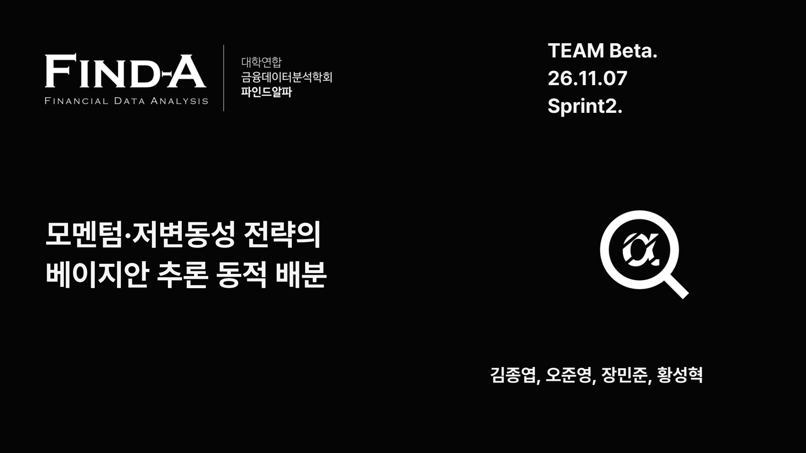

# 모멘텀·저변동성 전략의 베이지안 동적 배분

**FIND-A Sprint 2 · TEAM Beta**  
공동연구: **김종엽 · 오준영 · 장민준 · 황성혁**

KOSPI200과 S&P 500에서 모멘텀(M), 저변동성(L), 현금의 비중을 어떻게 정할지 연구했습니다. 두 전략에 50%씩 투자하는 경우와 베이지안 모형으로 비중을 바꾸는 경우를 비교했습니다. 한국과 미국은 거래일과 통화가 달라 별도 계좌로 계산했습니다.

공동연구 코드와 보고서, 발표자료를 모았습니다. 원본 저장소와 기준 커밋은 [출처](ATTRIBUTION.md)에 적었습니다.

## 먼저 볼 자료

| 자료 | 내용 |
|---|---|
| [최종 발표 PDF](reports/presentation/Beta_Sprint2_Final.pdf) | 제공된 발표자료 원본, 표지 포함 52쪽 |
| [발표 PPTX](reports/presentation/Beta_Sprint2_Final_view_only.pptx) | PDF 각 페이지를 그대로 넣은 보기용 변환본 |
| [발표자료 안내](reports/presentation/README.md) | 원본·변환본 구분과 파일 정보 |
| [최종 연구 보고서](reports/final/README.md) | 시장별 성과, 통계적 비교, 해석과 한계 |
| [수리 모형](docs/mathematics.md) · [연구 방법](docs/methodology.md) | 신호부터 예측·배분·체결·평가까지의 정의 |
| [데이터 규격](docs/data.md) · [수치 검증](docs/numerical_validation.md) | 입력 파일, 재현 방법, 모형의 안정성 |



PPTX는 PDF 52쪽을 이미지 슬라이드로 옮긴 보기용 파일입니다. 글과 차트의 개별 편집은 불가능합니다. 발표자료는 발표 당시 버전이며, 이후 보완된 성과 수치와 검증 결과는 최종 연구 보고서에 있습니다.

## 연구에서 다룬 문제

두 전략을 고정 비중으로 보유하는 것보다 시장 상황에 따라 비중을 바꾸는 편이 나은지 살펴봤습니다. 예상 수익과 위험을 추정한 뒤, 거래비용을 차감하고도 비중을 바꿀 이유가 있는지 판단했습니다. 투자하지 않은 금액은 현금으로 남겼습니다.

| 구성 | 기준 |
|---|---|
| 모멘텀 M | 현재 가격을 최근 504거래일 최고가로 나눈 값이 높은 종목 |
| 저변동성 L | 최근 60거래일 수익률의 표준편차가 낮은 종목 |
| 20·40 규칙 | 신호 순위 상위 20%에서 신규 편입, 기존 보유종목은 상위 40% 안에 있으면 유지 |
| 종목 재선정 | 월말 기준으로 판단하고 다음 거래일 종가에 체결 |
| 배분 대상 | 모멘텀 전략, 저변동성 전략, 현금 |
| 비교 정책 | M_only, L_only, EW_monthly, Cash_timing, B0, B1, B2, B2_1, B2_2 |

20·40 규칙은 편입 기준 근처에서 순위가 오르내릴 때 같은 종목을 반복해서 사고파는 일을 줄이기 위한 장치입니다. 기존 종목은 순위가 상위 20% 밖으로 밀려나도 40% 안에 있으면 보유합니다.

모든 정책에 같은 체결·비용 규칙을 적용하고 현금과 보유수량을 장부에 기록했습니다. B2.1은 국면 간 평균을 공유하는 모형이고, B2.2는 두 전략의 공동 국면과 공분산을 추정하는 모형입니다. 계산식은 수리 모형 문서에 적었습니다.

## 결과와 해석

전체 평가기간은 2012–2025년, 개발기간은 2012–2019년, 테스트 구간은 2020–2025년입니다. 아래는 저장된 최종 보고서의 테스트 구간 결과입니다. 배당을 제외한 가격수익률에 거래비용을 반영했으며, 과거 자료를 이용한 연구 결과입니다.

| 시장 | 정책 | CAGR | Sharpe | MDD |
|---|---|---:|---:|---:|
| KOSPI200 | 모멘텀 단독 | 16.49% | 0.876 | −34.55% |
| KOSPI200 | 월별 50:50 | 13.25% | 0.805 | −34.15% |
| KOSPI200 | B2 | 10.66% | 0.768 | −29.31% |
| S&P 500 | 월별 50:50 | 4.41% | 0.437 | −23.63% |
| S&P 500 | B2 | 4.56% | 0.507 | −19.68% |

한국에서는 모멘텀 단독의 수익률이 강했습니다. 미국 B2는 50:50과 비슷한 수익률에서 최대낙폭을 줄였지만, 50:50 대비 CER 차이의 95% 구간은 0을 포함했습니다. 따라서 동적 배분의 우위가 통계적으로 입증됐다고 해석하지 않았습니다.

미국 B2의 테스트 연환산 회전율은 4.33배로 50:50의 1.58배보다 높았습니다. 낙폭 개선과 함께 잦은 배분 변경에 따른 비용도 살펴봐야 합니다. 확장 모형의 비교, B2.2의 유효표본수와 표본 수 민감도는 [최종 보고서](reports/final/README.md)와 [수치 검증](docs/numerical_validation.md)에 정리했습니다.

현금 이자는 0으로 두었고, 가격이 사라진 보유종목은 마지막 평가액을 유지했습니다. 미국 거래비용은 매수·매도 각각 6.5bp라는 가정값입니다. 배당, 상장폐지 결제, 실제 회수금액은 별도로 모형화하지 않았습니다. 이미 관찰한 자료를 이용한 선택이므로 새 미관측 표본에서의 검증과 구분합니다.

## 코드와 자료 구성

| 경로 | 역할 |
|---|---|
| `sprint2/` | 전략 신호, 베이지안 모형, 장부, 평가, CLI |
| `config/` | 공통·시장별 설정, 비용과 통화 |
| `reports/presentation/` | 발표 PDF, 보기용 PPTX, 표지 |
| `reports/final/` | 성과표·그림, 시장별 압축 재계산 자료 |
| `docs/` | 방법론, 수식, 데이터 규격, 선정 근거 |
| `tests/` | 체결·데이터 누출·시장·결과물 검증 |
| `tools/verify_final.py` | 두 시장의 결과 구성과 문서 링크 점검 |

## 실행 방법

Python 3.11 기준입니다. 패키지 버전은 `requirements.txt`, 입력 파일의 이름과 형식은 [데이터 규격](docs/data.md)에 있습니다.

```powershell
git clone https://github.com/Kimjongyeop-web/bayesian-strategy-allocation.git
cd bayesian-strategy-allocation
py -3.11 -m venv .venv
.\.venv\Scripts\python -m pip install -r requirements.txt
.\.venv\Scripts\python -m pytest -q
.\.venv\Scripts\python tools/verify_final.py
```

저장된 압축 결과만으로 보고서와 그림을 다시 만들 수 있습니다. 아래 명령은 `reports/final/`의 보고서와 그림을 갱신합니다.

```powershell
.\.venv\Scripts\python -m sprint2 report reports/final
```

전체 백테스트는 [데이터 규격](docs/data.md)에 적힌 원본 두 파일을 `data/raw/`에 준비한 뒤 실행합니다. 원자료와 캐시는 저장소에 포함되어 있지 않습니다.

```powershell
.\.venv\Scripts\python -m sprint2 check-data --market all
.\.venv\Scripts\python -m sprint2 run --market all --run-id full
```

전체 실행 결과는 `results/comparison/<run_id>/`에 저장됩니다. 기존 결과와 이름이 겹치면 번호를 붙입니다.

[원본 README](UPSTREAM_README.md)
