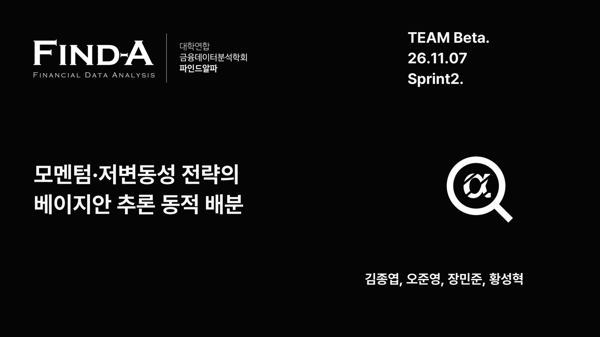

# 최종 발표자료

**FIND-A Sprint 2 · TEAM Beta**  
김종엽 · 오준영 · 장민준 · 황성혁

| 파일 | 설명 |
|---|---|
| [Beta_Sprint2_Final.pdf](Beta_Sprint2_Final.pdf) | 제공된 최종 발표 PDF 원본. 표지 포함 52쪽. 파일명만 변경했습니다. |
| [Beta_Sprint2_Final_view_only.pptx](Beta_Sprint2_Final_view_only.pptx) | PDF의 각 페이지를 같은 순서로 넣은 52장짜리 보기용 PPTX. |
| [cover.png](cover.png) | PDF 첫 페이지 미리보기. |

## PPTX의 범위

PDF 한 쪽을 PPTX 한 장에 그대로 넣었습니다. PowerPoint에서 발표용으로 사용할 수 있으며, 글·수식·차트의 개별 편집은 불가능합니다.

화면 비율은 16:9, 이미지 해상도는 1920×1080입니다. PDF 원본 파일명은 `Beta_Sprint2_최종발표.pdf`입니다.

## 함께 볼 자료

- [연구 개요와 실행 방법](../../README.md)
- [최종 연구 보고서](../final/README.md)
- [수리 모형](../../docs/mathematics.md)
- [출처·공동연구자](../../ATTRIBUTION.md)

발표자료는 발표 당시 버전입니다. 이후 보완된 수치와 검증 결과는 최종 연구 보고서에 있습니다.
